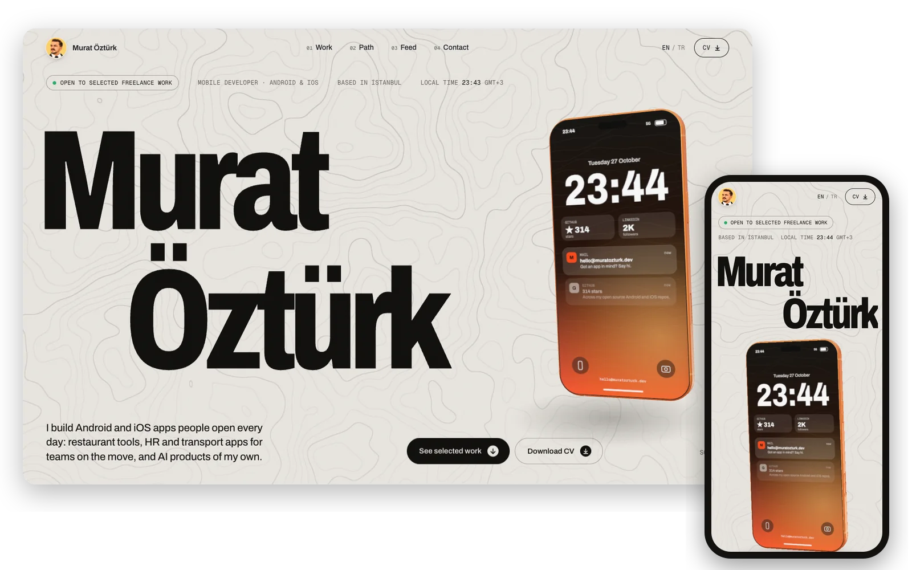

<a href="https://muratozturk.dev">
  <picture>
    <source media="(prefers-color-scheme: dark)" srcset="assets/banner-dark.svg">
    
  </picture>
</a>

  
  
  
  

### I build Android and iOS apps people open every day.

Restaurant tools used across Türkiye, HR and transport apps for teams on the move, and AI products of my own. Six years of native Kotlin and Swift, these days mostly Jetpack Compose, SwiftUI and Kotlin Multiplatform, with Node.js or .NET behind them when a product needs a backend.

- **Now:** native Android and iOS apps at **EasyHR AI Platform** and **Uris Tech**
- **Freelance:** 60+ white-label AI app builds for 58 clients worldwide
- **Before:** five years at Liwa Yazılım building the SambaPOS companion apps
- **Open to:** selected freelance work, from İstanbul

 

<picture>
  <source media="(prefers-color-scheme: dark)" srcset="assets/stats-dark.svg">
  
</picture>

  

<h3>
  <picture>
    <source media="(prefers-color-scheme: dark)" srcset="assets/h-work-dark.svg">
    
  </picture>
</h3>

<table>
  <tr>
    <td width="33%" valign="top">
       
      <b>APF: Auto Part Finder</b> 
      One search across 59 auto parts suppliers, with VIN lookup, POS and e-invoicing. Desktop, Android, iOS. 
      <a href="https://apps.apple.com/tr/app/apf-auto-part-finder/id6820951022">App Store</a> · <a href="https://play.google.com/store/apps/details?id=com.autopartfinder.mobile">Google Play</a>
    </td>
    <td width="33%" valign="top">
       
      <b>Uris Pro · Kids · 360</b> 
      Live staff and school transport for passengers, drivers and fleet managers. 1K+ installs, 4.6 on the App Store. 
      <a href="https://apps.apple.com/tr/app/uris-pro/id6757388425">App Store</a> · <a href="https://play.google.com/store/apps/details?id=com.uristech.uris">Google Play</a>
    </td>
    <td width="33%" valign="top">
       
      <b>EasyHR AI Platform</b> 
      HR in a pocket: geofence, NFC and QR attendance, leave, approvals and a team feed. Compose + SwiftUI. 
      <a href="https://apps.apple.com/tr/app/easyhr-ai-platform/id6791637017">App Store</a> · <a href="https://play.google.com/store/apps/details?id=com.tlsyazilim.easyhr">Google Play</a>
    </td>
  </tr>
  <tr>
    <td width="33%" valign="top">
       
      <b>Samba Patron</b> 
      The SambaPOS owner app: live revenue and branch reports, shipped in 2021. 4.5 from 91 ratings, 1K+ installs. 
      <a href="https://apps.apple.com/tr/app/samba-patron-samba-boss/id1598881147">App Store</a> · <a href="https://play.google.com/store/apps/details?id=com.devearth.sambapatron">Google Play</a>
    </td>
    <td width="33%" valign="top">
       
      <b>Samba Mobile</b> 
      Waiters take orders and payments at the table, synced live with SambaPOS. One Compose Multiplatform codebase. 
      <a href="https://apps.apple.com/tr/app/samba-mobile/id6807137864">App Store</a> · <a href="https://play.google.com/store/apps/details?id=com.liwasoft.mobileclient">Google Play</a>
    </td>
    <td width="33%" valign="top">
       
      <b>White-label AI apps</b> 
      Chat, image, video and music apps built on OpenAI, RunwayML and Suno, delivered as custom builds for 58 freelance clients.
    </td>
  </tr>
  <tr>
    <td width="33%" valign="top">
       
      <b>KidAI: Storytime Magic</b> 
      Bedtime stories written and read aloud by AI. One Compose Multiplatform codebase, Gemini and ElevenLabs. 
      <a href="https://apps.apple.com/tr/app/kidai-storytime-magic/id6746138096">App Store</a> · <a href="https://play.google.com/store/apps/details?id=app.kidai">Google Play</a>
    </td>
    <td width="33%" valign="top">
       
      <b>generate.tr</b> 
      Browser tools for app makers: store screenshots, AI icons, localisation. Seven apps, one sign-in, 35 languages. 
      <a href="https://generate.tr">generate.tr</a> · <a href="https://screenshot.generate.tr">screenshot</a>
    </td>
    <td width="33%" valign="top">
       
      <b>Mova</b> 
      My most starred repo: a TMDb movie app built as a clean architecture reference, also on Google Play. 
      <a href="https://github.com/muratozturk5/Mova">GitHub</a> · <a href="https://play.google.com/store/apps/details?id=com.muratozturk.mova">Google Play</a>
    </td>
  </tr>
</table>

Open source too: <a href="https://github.com/muratozturk5/Mova">Mova</a>, <a href="https://github.com/muratozturk5/OpenAI-Dall-E-2">OpenAI DALL·E 2 client</a>, <a href="https://github.com/muratozturk5/Kotlin-Order-Food-App">Order Food app</a>, and merged pull requests to <a href="https://github.com/vorssaint/vorssaint-utils/pulls?q=is%3Apr+author%3Amuratozturk5">vorssaint-utils</a> (30k stars).

  

<h3>
  <picture>
    <source media="(prefers-color-scheme: dark)" srcset="assets/h-site-dark.svg">
    
  </picture>
</h3>

<b><a href="https://muratozturk.dev">muratozturk.dev</a></b> · selected work, work timeline, posts and my CV, in English and Turkish

 

<h3>
  <picture>
    <source media="(prefers-color-scheme: dark)" srcset="assets/h-toolbox-dark.svg">
    
  </picture>
</h3>

<picture>
  <source media="(prefers-color-scheme: dark)" srcset="https://skillicons.dev/icons?i=kotlin%2Cswift%2Cjava%2Candroidstudio%2Cflutter%2Cts%2Cnodejs%2Cnestjs%2Cexpress%2Cdotnet%2Ccs%2Cpostgres%2Cprisma%2Creact%2Cnextjs%2Cfirebase%2Cdocker%2Cgit%2Cthreejs%2Celectron&theme=dark&perline=10">
  
</picture>

Jetpack Compose · SwiftUI · Kotlin Multiplatform · Compose Multiplatform · Coroutines & Flow · Hilt · Koin · Ktor · Room · Retrofit · MVVM · MVI · Clean Architecture · OpenAI · Gemini · ElevenLabs

  

<h3>
  <picture>
    <source media="(prefers-color-scheme: dark)" srcset="assets/h-elsewhere-dark.svg">
    
  </picture>
</h3>

Got an app in mind, a role to fill or a question about Android, iOS or KMP? Write to **[hello@muratozturk.dev](mailto:hello@muratozturk.dev)** or find me on **[LinkedIn](https://www.linkedin.com/in/muratozturk5)**. I usually reply within a day.
